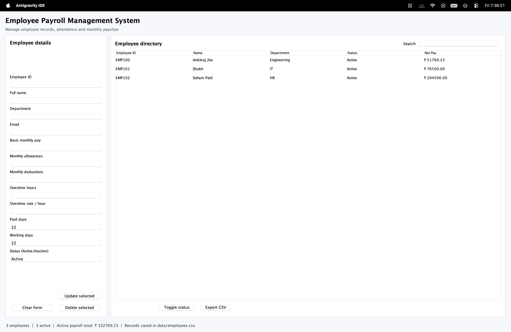
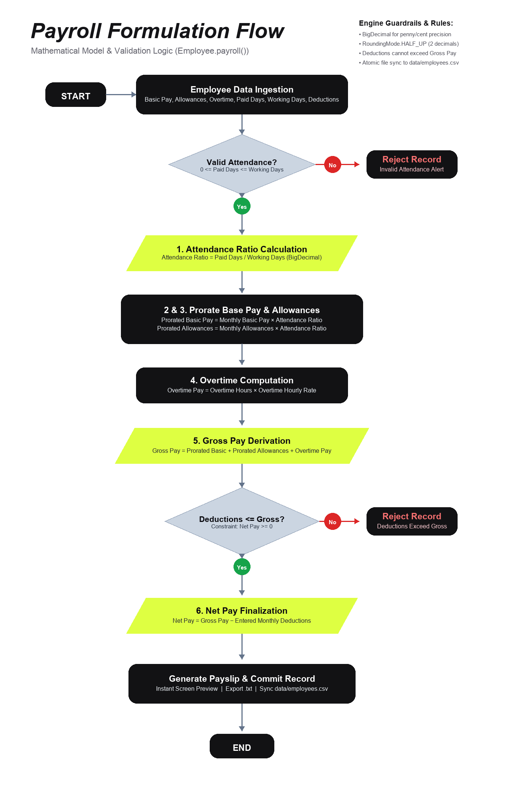

# Employee Payroll Management System

[](https://www.oracle.com/java/)
[]()
[]()
[](Java_Final_Report.pdf)

A dependency-free Java Swing desktop application designed and implemented for **Case Study no. 131** (*School of Future Tech / ITM Skills University*). The system manages complete employee lifecycles, attendance tracking, mathematical payroll prorating, financial exception validation, and CSV persistence with zero external third-party dependencies.

---

## 🖥️ Application Interface



*Figure 1: Production Java Swing GUI showing the Employee Details management form, live searchable Directory with Net Pay calculations, and aggregate payroll summary metrics.*

---

## 🚀 Key Features

- **Full Lifecycle Employee Management**: Create, update, search, sort, and soft-delete/deactivate employee records without data loss.
- **High-Precision Payroll Engine**: Strict financial calculations powered by `java.math.BigDecimal` using `HALF_UP` rounding to completely eliminate floating-point drift.
- **Attendance-Adjusted Proration**: Automatically calculates prorated basic salary and allowances based on monthly working vs. paid attendance days.
- **Instant Search & Sort**: Real-time multi-attribute filtering (ID, Name, Department, Status) across employee records.
- **Defensive Input Validation**: Validates mandatory fields, regex-compliant email formats, non-negative numbers, attendance boundaries (`Paid Days <= Working Days`), and duplicate IDs.
- **Business Rule Constraints**: Enforces payroll sanity checks—instantly rejects calculation if total monthly deductions exceed gross salary (`Net Pay < 0`).
- **Interactive Payslip Generation**: Previews formatted salary breakdown slips on-screen with one-click export to local text files.
- **Robust Persistence & Export**: Saves records atomically to `data/employees.csv` with standard RFC-4180 CSV escaping and provides on-demand CSV backup export.

---

## 📐 Mathematical Formulation of Payroll

The mathematical model implemented in `PayrollApp.java` operates under the following formalized equations:

$$\text{Attendance Ratio} = \frac{\text{Paid Days}}{\text{Working Days}}$$

$$\text{Prorated Basic Pay} = \text{Monthly Basic Pay} \times \text{Attendance Ratio}$$

$$\text{Prorated Allowances} = \text{Monthly Allowances} \times \text{Attendance Ratio}$$

$$\text{Overtime Pay} = \text{Overtime Hours} \times \text{Overtime Hourly Rate}$$

$$\text{Gross Pay} = \text{Prorated Basic Pay} + \text{Prorated Allowances} + \text{Overtime Pay}$$

$$\text{Net Pay} = \text{Gross Pay} - \text{Monthly Deductions}$$

$$\textbf{Constraint Rule: } \text{If } \text{Deductions} > \text{Gross Pay} \ (\text{Net Pay} < 0) \implies \textbf{Reject Transaction}$$

### Payroll Processing Flowchart



*Figure 2: Formal process flowchart depicting parameter extraction, attendance ratio validation, overtime pay computation, gross & net pay calculation, and deduction rejection constraints.*

---

## ☕ Core Java Concepts Implemented

| Java Concept | Application in System |
| :--- | :--- |
| **Object-Oriented Programming (OOP)** | Domain entity encapsulation via immutable records (`PayBreakdown`) and structured state models (`Employee`). |
| **ArrayList** | Maintains ordered dynamic sequence of records for responsive rendering in GUI tables and iteration. |
| **HashMap** | Guarantees instant $O(1)$ key-based lookup and duplicate validation by Employee ID. |
| **TreeMap** | Maintains natural lexicographical ordering of employee keys for structured alphabetical persistence. |
| **BigDecimal Arithmetic** | Prevents IEEE 754 floating-point inaccuracies in currency calculations. |
| **Exception Handling** | Robust user-facing error reporting via custom validation exceptions (`ValidationException`). |
| **Atomic File I/O** | Safe CSV parsing, quoting/escaping, and atomic replacement via `java.nio.file.StandardCopyOption`. |

---

## 📁 Repository Structure

```text
├── src/
│   └── PayrollApp.java         # Main Java Swing Application & Domain Logic
├── test/
│   └── PayrollAppTest.java     # Automated Headless Unit & Round-Trip Tests
├── data/
│   └── employees.csv           # Local persistent employee database
├── Java_Final_Report.pdf       # Comprehensive Academic Case Study Report
├── ui.png                      # Application UI screenshot
├── payroll_flowchart.png       # High-resolution mathematical logic flowchart
├── run.sh                      # One-click execution shell script
├── test.sh                     # Automated test runner script
├── .gitignore                  # Git ignore rules for build & temporary files
└── README.md                   # Project documentation and guide
```

---

## 🛠️ Requirements & Setup

### Prerequisites
- **Java Development Kit (JDK)**: JDK 17 LTS or JDK 21 LTS recommended.
- **Operating System**: macOS, Linux, or Windows with a desktop GUI environment.
- **Build Tools**: None required (Zero external dependencies, pure standard library).

---

## 🏃 Quick Start

### 1. Run the Application
You can launch the application with a single command:

```bash
chmod +x run.sh
./run.sh
```

Or manually compile and run via the Java CLI:
```bash
# Compile
javac -d out src/PayrollApp.java

# Execute
java -cp out PayrollApp
```

### 2. Run Automated Verification Tests
Execute the headless verification test suite (validates calculation accuracy, boundary conditions, and CSV round-trip serialization):

```bash
chmod +x test.sh
./test.sh
```

Expected output:
```text
All payroll calculation and CSV round-trip tests passed.
```

---

## 📄 Academic Documentation

The complete project case study report submitted for evaluation is included in this repository:
- 📑 **[Java_Final_Report.pdf](Java_Final_Report.pdf)**: Detailed academic documentation covering Problem Statement, System Architecture, Mathematical Formulations, Code Implementation, Testing Results, and References.
